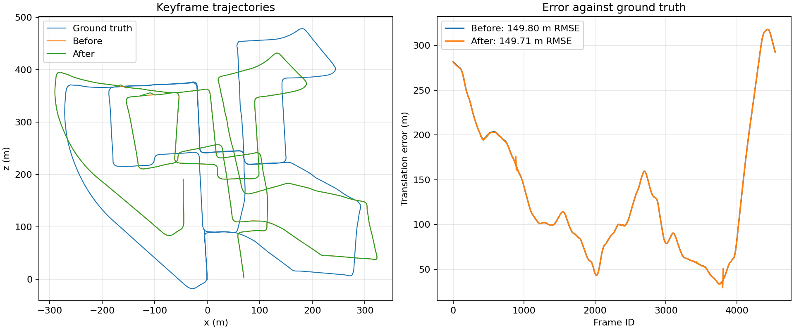

# Mini Stereo SLAM

基于高翔《视觉 SLAM 十四讲》第 13 章的双目 SLAM 学习项目。在原有系统上补充了 ORB 回环检测、PnP 几何验证和 g2o 位姿图优化，并加入轨迹评估与离线实验工具。

项目在 KITTI Odometry 00 上完成了全序列运行，包含从双目图像输入、关键帧与稀疏地图，到回环约束和轨迹评估的完整流程。

## 功能

- 双目图像跟踪、关键帧管理与稀疏地图构建
- 局部 Bundle Adjustment
- ORB 历史关键帧候选检索
- PnP + RANSAC 回环几何验证
- g2o 全局位姿图优化
- 关键帧轨迹导出、KITTI 真值对比和 ATE 评估
- 无界面运行与位姿图离线重放，便于复现实验和比较参数

## 系统流程

```text
KITTI 双目图像
      ↓
前端跟踪 → 关键帧与稀疏地图 → 局部 BA
      ↓                         ↓
ORB 候选检索 → PnP + RANSAC → 回环约束
                                  ↓
                    全局位姿图优化与轨迹评估
```

全局位姿图优化在当前版本中于序列结束后执行。项目重点是学习和验证双目 SLAM 的模块调用与回环流程。

## 运行环境

已在 WSL Ubuntu 环境中编译并运行。项目依赖 Eigen3、OpenCV、Pangolin、Sophus、g2o、SuiteSparse/CSparse、glog、gflags、GTest、Boost 和 OpenGL。

准备 KITTI Odometry 数据，目录结构如下：

```text
dataset/
├── sequences/00/
│   ├── calib.txt
│   ├── image_0/
│   └── image_1/
└── poses/00.txt
```

在 `config/default.yaml` 中设置 `dataset_dir` 为 `sequences/00` 的路径。真值文件 `poses/00.txt` 只用于评估。

## 编译与运行

```bash
cmake -S . -B build
cmake --build build -j2
ctest --test-dir build --output-on-failure
mkdir -p results
./bin/run_kitti_stereo --config_file=./config/default.yaml
```

无图形界面的实验运行：

```bash
./bin/run_kitti_stereo --headless --config_file=./config/default.yaml
```

程序结束后会在 `results/` 输出逐帧轨迹、优化前后的关键帧轨迹和回环约束。

## 轨迹评估

安装评估脚本依赖：

```bash
python3 -m pip install numpy matplotlib
python3 scripts/compare_trajectories.py --ground-truth /path/to/poses/00.txt
```

脚本会绘制关键帧轨迹并输出平移 ATE RMSE。实验结果图：



## 一次 KITTI 00 实验

使用相同的轨迹对齐方式，关键帧平移 ATE RMSE 从优化前的 **147.070 m** 降至离线回放优化后的 **112.941 m**。该结果来自回环约束筛选和较长迭代设置，用于展示实验流程与参数影响；具体复现方法见下方工具说明。

## 实验工具

导出回环约束后，可离线调整位姿图参数，不必重新处理整段图像：

```bash
./bin/replay_pose_graph \
  results/keyframes_before.txt \
  results/loop_constraints.txt \
  results/keyframes_replayed.txt \
  100 1 15000 lm 20
```

参数依次为回环边权重、Huber 阈值、最大迭代次数、优化方法和可选的回环平移筛选阈值（米）。结果可使用轨迹评估脚本与 KITTI 真值比较。

## 项目结构

| 路径 | 内容 |
| --- | --- |
| `app/` | KITTI 运行入口与位姿图离线重放工具 |
| `include/myslam/` | SLAM 模块接口与 g2o 类型 |
| `src/` | 前端、后端、地图、数据集和可视化实现 |
| `config/` | 相机与数据集配置 |
| `scripts/` | 轨迹与回环约束评估脚本 |
| `test/` | 三角化、几何筛选与位姿图相关测试 |
